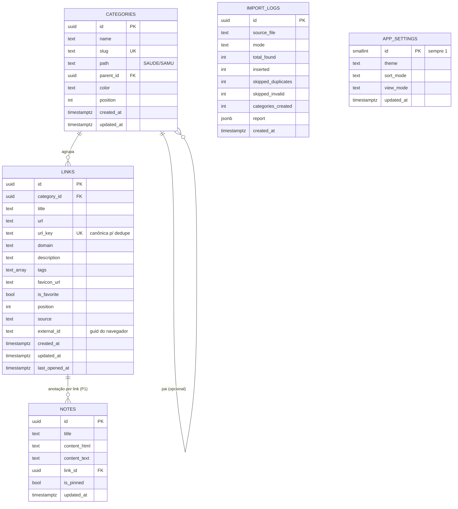

# LinkSpace — Arquitetura do sistema

> Organizador de links pessoal ("favoritos") com importação idempotente de JSON,
> exportação seletiva, categorias, busca, modo de organização, tema claro/escuro
> e anotações ricas persistidas no Supabase.

| Item | Valor |
|---|---|
| Versão do documento | 1.0 |
| Data | 2026-11-13 |
| Status | Arquitetura aprovada para implementação (P0) |
| Entregáveis de código | `index.html`, `app.js`, `styles.css` + `supabase/schema.sql` |
| Prompt de geração | [`docs/PROMPT.md`](./PROMPT.md) |

---

## 1. Visão geral

### 1.1 Problema

O usuário acumulou **175 links** (174 únicos) em 12 pastas do Firefox e não tem onde
organizá-los, buscar, anotar ou migrar entre navegadores sem perder o que já existe.
Exportações sucessivas do navegador geram sobreposição massiva de URLs.

### 1.2 Objetivo

Uma aplicação web estática, sem build, que:

1. **Importa** um JSON de bookmarks (Firefox, Chrome/Edge ou formato genérico do app)
   e é **idempotente**: links repetidos são ignorados, novos são adicionados.
2. **Exporta** links escolhidos pelo usuário (ou todos) em JSON, HTML de navegador ou CSV.
3. **Organiza** os links em cards agrupados por categoria, com busca e filtro.
4. **Gerencia** (editar/excluir) via "modo organizar".
5. **Anota** em um editor rico (negrito/itálico/sublinhado) salvo no banco.
6. **Alterna** tema claro/escuro com persistência.

### 1.3 Princípios de arquitetura

| Princípio | Consequência prática |
|---|---|
| **Zero build** | Nada de npm/webpack; ES Modules nativos + CDN do `supabase-js`. Abre por duplo clique ou GitHub Pages. |
| **Banco como fonte de verdade** | O Supabase (Postgres) guarda links, categorias, notas e preferências; `localStorage` só guarda configuração de conexão, tema e cache. |
| **Idempotência** | Chave canônica `url_key` com índice `UNIQUE`; importar duas vezes o mesmo arquivo insere 0 registros. |
| **URL original preservada** | `url` (exibida/aberta) ≠ `url_key` (comparação). Nunca se perde query string significativa. |
| **Degradação graciosa** | Sem conexão: interface carrega do cache, mostra chip "Erro ao conectar" e permite tentar de novo. |
| **Operações atômicas** | Importação inteira em uma única chamada RPC/transação; nunca fica pela metade. |

### 1.4 Métricas de sucesso

- Importar o `bookmarks-2026-11-13.json` gera **11 categorias** e **174 links**, e uma
  segunda importação do mesmo arquivo gera **0 inserções / N duplicados**.
- Busca responde em **< 50 ms** para 1.000 links.
- Carga inicial (cache quente) **< 1 s**; primeira visita **< 2,5 s** em 4G.
- Nenhum dado do usuário em serviço de terceiros além do Supabase.

---

## 2. Escopo

### 2.1 Dentro do escopo (P0)

- CRUD de links (criar, ler, atualizar, excluir) e criação automática de categorias.
- Importação JSON com detecção de formato, validação, pré-visualização e relatório.
- Exportação com seleção (todos / filtrados / individuais) em 3 formatos.
- Categorias (pastas) com contagem; sidebar de navegação.
- Busca global (título, URL, domínio, categoria, tags), insensível a acentos.
- Modo organizar (editar/excluir) e botão "Novo Link" nesse modo.
- Tema claro/escuro persistido (localStorage + `app_settings`).
- Modal de anotações com B/I/U, autosave e salvamento no banco.
- Indicador de estado da conexão com o Supabase.
- Responsivo (mobile → desktop), acessível (AA) e com estados vazios/erro/loading.

### 2.2 Fora do escopo (backlog)

| Item | Fase |
|---|---|
| Autenticação multiusuário (Supabase Auth) | P2 |
| Importar HTML de navegador, CSV, Pocket, Raindrop | P2 |
| Extensão de navegador / bookmarklet | P3 |
| IA para sugerir categoria/tags | P3 |
| Compartilhamento público de coleções | P3 |
| Drag & drop para reordenar/mover entre categorias | P2 |
| Histórico de versões / lixeira com restauração | P2 |
| Verificação automática de links quebrados | P3 |
| Snapshot/thumbnail de página | P3 |

---

## 3. Personas e casos de uso

**Persona única (v1):** profissional de TI/saúde que mantém dezenas de sistemas e
vídeos de referência e usa Firefox + celular.

| ID | Caso de uso | Pré-condição | Fluxo resumido | Pós-condição |
|---|---|---|---|---|
| UC-01 | Importar bookmarks do navegador | `bookmarks.json` em mãos | Abre sidebar → Importar → arrasta o JSON → vê prévia (novos/duplicados) → Importar | Links novos gravados; duplicados ignorados; relatório exibido |
| UC-02 | Reimportar o mesmo arquivo | Já importado | Repete UC-01 | 0 inserções; "0 novos, 175 duplicados" |
| UC-03 | Exportar tudo | Existe ≥ 1 link | Sidebar → Exportar → Selecionar todos → JSON → Exportar | Download `linkspace-AAAA-MM-DD.json` |
| UC-04 | Exportar um subconjunto | Idem | Exportar → busca/marca 12 links → HTML → Exportar | Arquivo importável no Firefox com esses 12 links |
| UC-05 | Encontrar link antigo | Existe ≥ 1 link | Digita "sisa" na busca do topo | Grid filtrado, contador e destaque do termo |
| UC-06 | Corrigir título/categoria | Modo organizar ligado | Clica no lápis → edita → Salvar | Card atualizado com toast |
| UC-07 | Excluir link | Modo organizar ligado | Clica na lixeira → confirma | Card removido; opção desfazer (P1) |
| UC-08 | Adicionar link manual | Modo organizar ligado | "Novo Link" → preenche → Salvar | Card no topo da categoria |
| UC-09 | Anotar senhas de teste/emails | Sessão aberta | "Anotações" → digita → formata → Salvar | Nota salva no banco, disponível em outro dispositivo |
| UC-10 | Alternar tema | — | Clique no ícone lua/sol | Tema aplicado em < 100 ms e persistido |

---

## 4. Visão de arquitetura

```
┌─────────────────────────────────────────────────────────────────────────┐
│ NAVEGADOR — 3 arquivos estáticos, zero build                            │
│                                                                         │
│  index.html ── estrutura semântica, SVG sprite, meta tags               │
│  styles.css ── tokens, temas (light/dark), layout, responsivo           │
│  app.js     ── CONFIG → util → url → import/export → api → state → ui   │
│                render = f(state); a UI nunca fala com o banco           │
│                                                                         │
│  localStorage: configuração do Supabase · tema · cache de leitura       │
└───────────────────────────────┬─────────────────────────────────────────┘
                                │ HTTPS (PostgREST + RPC)
                                ▼
┌─────────────────────────────────────────────────────────────────────────┐
│ SUPABASE                                                                │
│  PostgREST ── RLS ── Postgres                                           │
│   tabelas: categories · links · notes · import_logs · app_settings      │
│   views:   v_categories (contagem) · v_stats                            │
│   RPC:     import_links(payload, mode, source) · search_links(q, limit) │
└─────────────────────────────────────────────────────────────────────────┘
```

### 4.1 Camadas dentro de `app.js`

O arquivo é único, mas **estruturalmente em camadas** (IIFE ou ES module com seções
comentadas). Nenhuma camada de UI chama `supabase` diretamente.

| Camada | Responsabilidade | Principais símbolos |
|---|---|---|
| `CONFIG` | Constantes, tabelas, limites, chaves de storage | `CONFIG`, `STORAGE_KEYS`, `MESSAGES` |
| `util` | Helpers puros (slug, datas, escape, debounce, hash) | `slugify`, `escapeHtml`, `debounce`, `formatDate` |
| `domain.url` | Canonicalização e validação de URL | `canonicalizeUrl`, `isValidUrl`, `extractDomain` |
| `domain.import` | Detecção de formato e normalização do JSON | `detectFormat`, `parseFirefox`, `parseChrome`, `parseGeneric`, `buildImportPayload` |
| `domain.export` | Geração de arquivos de exportação | `toJson`, `toNetscapeHtml`, `toCsv`, `downloadBlob` |
| `api` | Cliente Supabase, tratamento de erro, retry | `db.selectLinks`, `db.upsertLink`, `db.deleteLink`, `db.importPayload`, `db.getNote`, `db.saveNote` |
| `state` | Estado único + subscribe + persistência de preferências | `store.getState`, `store.setState`, `store.selectors` |
| `ui` | Render declarativo por template string, eventos delegados | `renderGrid`, `renderSidebar`, `openModal`, `toast` |
| `app` | Bootstrap, listeners globais, atalhos, tema | `init` |

### 4.2 Formato do estado

```js
{
  status: 'idle' | 'loading' | 'ready' | 'error',
  connection: 'checking' | 'online' | 'offline',
  theme: 'light' | 'dark',
  organizeMode: false,
  filters: { query: '', categoryId: null, onlyFavorites: false },
  data: {
    links: [],          // shape: { id, title, url, urlKey, domain, categoryId,
                        //          description, tags, faviconUrl, isFavorite,
                        //          createdAt, updatedAt }
    categories: [],     // shape: { id, name, slug, path, position, linkCount }
    note: { id, title, contentHtml, contentText, updatedAt }
  },
  ui: { sidebarOpen: false, modal: null, pendingDeleteId: null, importPreview: null },
  meta: { loadedAt: 0, lastError: null }
}
```

Regra: **render = f(state)**. Toda mutação passa por ações (`actions.setQuery`,
`actions.importFile`, `actions.saveLink`…) que chamam a API e só então atualizam o
estado — com *update otimista* apenas em edição/exclusão (com rollback em erro).

### 4.3 Carregamento da página (sequência)

1. `<script>` inline no `<head>` lê `localStorage.theme` e aplica `data-theme` (evita flash).
2. `app.js` carrega `config` do `localStorage` (`ls.supabase.url`, `ls.supabase.key`).
3. Se não houver config → abre modal **"Conectar ao Supabase"** (campos + teste).
4. Cria cliente `supabase.createClient(url, anonKey)`; testa com `select count` leve.
5. Carrega em paralelo: `links`, `categories` (`v_categories`), `notes`.
6. Renderiza sidebar + grid; encerra `loading` com skeletons.
7. Em erro: usa cache (`ls.cache.links`) se existir; senão, estado de erro com "Tentar novamente".

---

## 5. Modelo de dados

### 5.1 Diagrama entidade-relacionamento



DDL completo e pronto para execução: [`supabase/schema.sql`](../supabase/schema.sql).

### 5.2 Decisões de modelagem

| Decisão | Motivo |
|---|---|
| `url` + `url_key` separados | Deduplicar sem destruir parâmetros que o site realmente usa. `url_key` tem índice UNIQUE. |
| `categories.slug` único derivado de `path` | Importação pode usar `category_slug` sem risco de duplicar "SAUDE" vs "Saúde". |
| Categorias achatadas com `path` | A referência visual (screenshots) mostra lista plana na sidebar; `path` guarda a hierarquia para o futuro. |
| `tags text[]` + índice GIN | Busca por tag sem tabela de junção; suficiente para uso pessoal. |
| `source` + `external_id` | Rastreabilidade da origem (`firefox`, `chrome`, `manual`) e possibilidade de dedupe secundário pelo `guid`. |
| `notes` como tabela (não coluna em settings) | Permite várias notas e anotação por link no futuro; P0 usa uma nota global. |
| `import_logs` | Auditoria e relatório; base para "desfazer importação" (P1). |
| `app_settings` singleton | Tema/ordenação viajam entre dispositivos; `localStorage` continua sendo cache otimista. |
| `position` em links e categorias | Ordenação manual futura sem migração. |
| RLS habilitado desde o início | Evita retrabalho e permite alternar para "Modo B" sem mudar o front. |

### 5.3 Consultas do P0

```js
// leitura
supabase.from('links').select('*').order('created_at', { ascending: false })
supabase.from('v_categories').select('*').order('position').order('name')
supabase.from('notes').select('*').order('updated_at', { ascending: false }).limit(1)

// escrita
supabase.from('links').insert({...})
supabase.from('links').update({...}).eq('id', id)
supabase.from('links').delete().eq('id', id)
supabase.from('notes').upsert({ id, content_html, content_text, updated_at: new Date().toISOString() })

// importação (uma chamada só)
supabase.rpc('import_links', { payload, p_mode: 'merge', p_source: file.name })
```

> **Contrato de nomes:** o front usa `snake_case` (igual ao banco) e converte para
> `camelCase` só na borda de render, em `normalizeLink()`.

---

## 6. Segurança e configuração

### 6.1 Dois modos de implantação

| | **Modo A — pessoal (padrão)** | **Modo B — multiusuário** |
|---|---|---|
| Login | Nenhum | Supabase Auth (e-mail/senha ou magic link) |
| RLS | `using (true)` para `anon` | `user_id = auth.uid()` |
| Chave no front | `anon` (pública) | `anon` (pública) |
| Isolamento | Nenhum — quem tem a URL acessa os dados | Por usuário |
| Uso indicado | Local, rede doméstica, atrás de senha (Cloudflare Access / Vercel Protection) | Publicação na internet |
| SQL | `schema.sql` como está | bloco 10 do `schema.sql` |

> ⚠️ **No Modo A a chave `anon` permite escrita por qualquer visitante.** O prompt de
> implementação exige que a tela de configurações exiba esse aviso quando o modo estiver
> ativo. A chave `service_role` **nunca** é usada no front.

### 6.2 Configuração do cliente

- `SUPABASE_URL`, `SUPABASE_ANON_KEY` podem vir de constantes em `app.js` (para deploy)
  **ou** ser digitadas pelo usuário no modal "Conectar ao Supabase", persistidas em
  `localStorage` (`ls.supabase.url`, `ls.supabase.key`).
- Precedência: `localStorage` → constantes → modal de configuração.
- Botão "Testar conexão" faz `select id from categories limit 1` e reporta:
  falha de rede, chave inválida (`401`), tabela ausente (`404/PGRST205`) ou sucesso.
- A chave é mascarada na UI (`••••••••`) com botão "mostrar".

### 6.3 Setup do Supabase (passo a passo)

1. Criar projeto em <https://supabase.com> (região `South America (São Paulo)`).
2. **SQL Editor → New query** → colar e executar `supabase/schema.sql`.
3. **Project Settings → API** → copiar `Project URL` e `anon public key`.
4. Colar na tela "Conectar ao Supabase" do app (ou nas constantes de `app.js`).
5. (Modo B) **Authentication → Providers** → habilitar e-mail; criar usuário.
6. **Authentication → URL Configuration** → adicionar a URL do deploy em `Redirect URLs`.

### 6.4 Checklist de segurança do front

- [ ] Nunca logar a chave em console/analytics.
- [ ] Sanitizar todo HTML de anotação antes de renderizar (allowlist `b,i,u,strong,em,p,br,ul,ol,li,a[href]`).
- [ ] `rel="noopener noreferrer"` em todos os links externos.
- [ ] URLs validadas (`http/https`) antes de salvar e antes de renderizar `href`.
- [ ] Nenhum `eval`, nenhum `innerHTML` com dado do usuário sem escape.
- [ ] Favicon servido por URL https (não executar SVG vindo de `iconUri`).

---

## 7. Importação (núcleo do produto)

### 7.1 Formatos aceitos

| Formato | Assinatura (detecção) | Origem |
|---|---|---|
| `firefox` | objeto com `root: "placesRoot"` + `children[].type = "text/x-moz-place-container"` | Backup do Firefox |
| `chrome` | objeto com `roots` (`bookmark_bar`, `other`, `synced`) e `children[].type = "url"` | Chrome/Edge/Brave |
| `linkspace` | `{ app: "linkspace", version: 1, categories: [...], links: [...] }` | Exportação deste app |
| `generic` | array de `{title|name, url|uri, category|folder, tags}` | Scripts/manual |

Detecção: tenta `firefox` → `chrome` → `linkspace` → `generic`; se falhar, erro
`FORMATO_NAO_RECONHECIDO` com exemplos aceitos.

### 7.2 Normalização do Firefox (arquivo real do usuário)

```
placesRoot
├── menu (bookmarksMenuFolder)
│   ├── [links soltos]              -> categoria "DIVERSOS"
│   ├── DESIGN (2)                  -> "DESIGN"
│   ├── DOWNLOAD (5)                -> "DOWNLOAD"
│   ├── INTELIGENCIA ARTIFICIAL(37) -> "INTELIGENCIA ARTIFICIAL"
│   ├── Mozilla Firefox (4)         -> IGNORADA (pasta padrão do navegador)
│   ├── PEC - Video Aulas (5)       -> "PEC - VIDEO AULAS"
│   ├── PROGRAMAÇÃO (55)            -> "PROGRAMAÇÃO"
│   ├── SAUDE (12)                  -> "SAUDE"
│   │   └── SAMU (2)                -> "SAMU" (path "SAUDE/SAMU")
│   ├── VÍDEOS SISTEMAS SAUDE (22)  -> "VÍDEOS SISTEMAS SAUDE"
│   └── YouTube (1)                 -> "YOUTUBE"
├── toolbar (toolbarFolder, 11)     -> "BARRA DE FERRAMENTAS"
├── unfiled (0)                     -> ignorado (vazio)
└── mobile (0)                      -> ignorado (vazio)
```

Regras:

1. Percorrer recursivamente só `type` terminado em `container`; links são `text/x-moz-place`.
2. Cada pasta com ≥ 1 link vira categoria (nome = `title` da pasta, aparado).
3. Pastas aninhadas: categoria própria com `path` completo (`SAUDE/SAMU`).
4. Pastas padrão ignoradas por padrão (configurável): `Mozilla Firefox`,
   `Bookmarks Toolbar`, `Other Bookmarks`, `Favoritos do Firefox`, `unfiled`, `mobile`.
5. Links em `dateAdded` (microssegundos) → `created_at` em ISO.
6. `iconUri`:
   - `data:image/...;base64,...` só é mantido se ≤ 4 KB e se `CONFIG.storeInlineIcons`
     estiver ligado; caso contrário `favicon_url = null` (o app resolve por `s2/favicons`).
   - `fake-favicon-uri:*` → `null`.
7. Título vazio → usa domínio (`esus.altolonga.pi.gov.br`).
8. Itens sem `uri` ou com esquema ≠ http(s) (`javascript:`, `place:`, `file:`) vão para
   `invalidos` no relatório.
9. `external_id` = `guid`.

### 7.3 Algoritmo de importação (executado no cliente)

```
1. ler arquivo (máx. 5 MB) -> JSON.parse  (erro -> FORMato/JSON inválido)
2. detectar formato
3. achatar em registros crus: { title, url, folderPath, dateAdded, iconUri, guid }
4. para cada registro:
     a. validar URL (http/https, ≤ 4096 chars)
     b. url_key = canonicalizeUrl(url)
     c. se url_key já visto NO ARQUIVO  -> duplicado (mantém a 1ª ocorrência)
     d. categorizar: slugify(folderPath) ou "diversos"
     e. montar link normalizado
5. comparar com o índice já carregado (url_keys em memória) -> duplicados "no banco"
6. prévia: total lido, novos, duplicados no arquivo, duplicados no banco, inválidos,
   categorias novas
7. ao confirmar: supabase.rpc('import_links', { payload, p_mode, p_source })
8. recarregar links/categorias; toast + relatório com números reais do servidor
```

- **Limites:** arquivo ≤ 5 MB, ≤ 5.000 links por importação, payload enviado em um único
  RPC (se passar de 1.000 links, dividir em lotes de 500 e somar relatórios).
- **Modos:** `merge` (padrão, ignora existentes) e `replace` (apaga tudo antes; exige
  digitar `APAGAR` no diálogo de confirmação).
- **Transação:** o RPC roda em uma transação; erro → nada é gravado.
- **Relatório:** `{total, inserted, duplicates, invalid, categories_created}` exibido em
  modal com lista expansível dos duplicados (título + URL) e botão "Exportar relatório".

### 7.4 Canonicalização de URL (`canonicalizeUrl`)

| Passo | Exemplo |
|---|---|
| trim e remover espaços internos | `" https://x.com/a "` → `https://x.com/a` |
| decodificar só caracteres não reservados (`%7E` → `~`) | `.../%7Euser` → `.../~user` |
| lowercase em esquema e host | `HTTPS://X.COM` → `https://x.com` |
| remover `www.` do host | `www.google.com` → `google.com` |
| remover porta padrão (`:80` em http, `:443` em https) | `https://x.com:443` → `https://x.com` |
| remover `/` final do caminho (exceto raiz) | `/pasta/` → `/pasta` |
| remover barra duplicada | `//a//b` → `/a/b` |
| remover parâmetros de rastreio | `utm_*`, `gclid`, `gbraid`, `wbraid`, `fbclid`, `msclkid`, `yclid`, `mc_cid`, `mc_eid`, `igshid`, `si`, `spm`, `_hsenc`, `_hsmi` |
| ordenar parâmetros restantes | `?b=2&a=1` → `?a=1&b=2` |
| remover fragmento (`#`) | `#secao` (configurável; `CONFIG.keepHash = false`) |
| normalizar `http`→`https` para comparação | `http://x.com` ≡ `https://x.com` (`CONFIG.dedupeHttp = true`) |

> `url` (original) **nunca** é alterada por esse processo. Também existe o caminho
> inverso: ao salvar manualmente uma URL sem esquema, prefixar `https://` e validar com
> `new URL()`.

Casos reais do arquivo do usuário: `https://cadastro.saude.gov.br/.../usuarioConsulta.jsp`
aparece **2×** (uma em `SAUDE`, outra em `SAUDE/SAMU`) → 1 link gravado, 1 duplicado.
`https://www.google.com/...&utm_source=...` e a mesma URL sem `utm` são o mesmo link.

---

## 8. Exportação

### 8.1 Seleção

- Modal "Exportar links" com: busca interna, "Selecionar todos" / "Selecionar filtrados"
  / "Limpar seleção", contador fixo (`12 de 175 selecionados`) e lista agrupada por
  categoria com checkbox por link e checkbox tri-estado por grupo.
- Estado padrão: tudo selecionado quando aberto a partir de "Exportar todos";
  nada selecionado quando aberto a partir de um filtro ativo (aí oferece
  "Selecionar os N resultados").
- Desabilitar "Exportar" com 0 selecionados.

### 8.2 Formatos

**JSON (`linkspace`) — round-trip perfeito**

```json
{
  "app": "linkspace",
  "version": 1,
  "exported_at": "2026-11-13T18:00:00.000Z",
  "count": 12,
  "categories": [{ "name": "SAUDE", "slug": "saude", "path": "SAUDE" }],
  "links": [{
    "title": "PEC - Cidadão",
    "url": "https://esus.altolonga.pi.gov.br/",
    "url_key": "https://esus.altolonga.pi.gov.br",
    "domain": "esus.altolonga.pi.gov.br",
    "category_slug": "saude",
    "tags": [],
    "created_at": "2026-07-28T12:32:24.000Z"
  }]
}
```

**HTML (Netscape Bookmark File) — importável em qualquer navegador**

```html
<!DOCTYPE NETSCAPE-Bookmark-file-1>
<META HTTP-EQUIV="Content-Type" CONTENT="text/html; charset=UTF-8">
<TITLE>Bookmarks</TITLE>
<H1>Bookmarks</H1>
<DL><p>
  <DT><H3>SAUDE</H3>
  <DL><p>
    <DT><A HREF="https://esus.altolonga.pi.gov.br/" ADD_DATE="1785...">PEC - Cidadão</A>
  </DL><p>
</DL><p>
```

**CSV (Excel/Sheets)** — separador `;`, UTF-8 **com BOM**, colunas:
`titulo;url;categoria;dominio;tags;descricao;favorito;criado_em`.

### 8.3 Nome do arquivo e entrega

`linkspace-{escopo}-{YYYY-MM-DD}.{ext}` (`todos`/`selecao`/`categoria-slug`).
Gerado com `Blob` + `URL.createObjectURL`; revogar a URL depois do clique.
Escapar sempre: `"` em CSV, `&<>"` em HTML, `JSON.stringify` em JSON.

---

## 9. Interface (UI/UX)

### 9.1 Mapa de telas

| Tela | Tipo | P0 |
|---|---|---|
| Grid de links ("Todos"/categoria) | principal | ✅ |
| Sidebar (drawer) | painel | ✅ |
| Modal Novo/Editar link | modal | ✅ |
| Modal Anotações | modal grande | ✅ |
| Modal Importar | modal + dropzone | ✅ |
| Modal Exportar | modal + checklist | ✅ |
| Modal de exclusão | dialog de confirmação | ✅ |
| Tela/estado "Erro ao conectar" | banner + modal de configuração | ✅ |

### 9.2 Layout (desktop ≥ 1280 px)

```
┌────────────────────────────────────────────────────────────────────────────┐
│ ☰   [ Pesquisar... ]                  Anotações   status   lua   Organizar │
├────────────────────────────────────────────────────────────────────────────┤
│ Todos                                                       175 links      │
│                                                                            │
│ ┌──────────┐ ┌──────────┐ ┌──────────┐ ┌──────────┐ ┌──────────┐           │
│ │ ico  tít │ │          │ │          │ │          │ │          │           │
│ │      dom │ │          │ │          │ │          │ │          │           │
│ └──────────┘ └──────────┘ └──────────┘ └──────────┘ └──────────┘           │
│                                                                            │
│ INTELIGENCIA ARTIFICIAL                                        37          │
│ ┌──────────┐ ...                                                           │
└────────────────────────────────────────────────────────────────────────────┘
```

- Sidebar é **drawer sobreposto** (300 px + backdrop `rgba(15,23,42,.45)`), aberta pelo
  hambúrguer; fecha com `Esc`, clique no backdrop ou navegação.
- Conteúdo centralizado, `max-width: 1600px`, `padding: 24px`, `gap: 16px`.
- Em modo organizar, a barra ganha o botão primário **"Novo Link"** à esquerda de
  **"Organizar"**, e "Organizar" passa ao estado ativo (fundo azul).

### 9.3 Componentes e medidas

| Componente | Especificação |
|---|---|
| Card | `grid-template-columns: 36px 1fr`, `padding: 14px 16px`, `radius: 12px`, borda 1px, fundo `--surface`, hover eleva 1px + sombra; título 14px/1.35 com clamp de 2 linhas; domínio 12px `--text-muted` com ellipsis |
| Favicon | 32×32, `radius: 6px`, `loading="lazy"`, fallback: monograma com cor derivada de hash do domínio |
| Ações do card (organizar) | 2 botões 28×28, ghost, canto superior direito, `aria-label="Editar link"` / `"Excluir link"`, revelados por hover **e sempre visíveis em telas touch** |
| Cabeçalho de categoria | nome em caixa alta, 12px, `letter-spacing: .06em`, `--text-muted`, contador à direita, margem `32px 0 12px` |
| Busca | pill 40px, ícone à esquerda, `max-width: 440px`, centralizada, debounce 200 ms, atalho `/` e `Ctrl/⌘+K`, limpar com `Esc` |
| Botões | primário azul, secundário com borda, ghost para ícones; altura 40px; `radius: 8px` |
| Modal | `max-width: 720px` (anotações) / `480px` (form/confirm), `radius: 16px`, sombra forte, `Esc` fecha, foco preso |
| Toast | canto inferior direito, 4 s, `aria-live="polite"`, variantes success/error/info |

### 9.4 Tokens de design (obrigatórios)

```css
:root {
  --bg: #f4f7f9;            --surface: #ffffff;
  --surface-2: #eef2f6;     --border: #e2e8f0;
  --border-strong: #cbd5e1;
  --text: #1e293b;          --text-muted: #64748b;
  --primary: #2563eb;       --primary-hover: #1d4ed8; --primary-soft: #dbeafe;
  --danger: #dc2626;        --success: #16a34a; --warning: #d97706;
  --radius-sm: 8px; --radius-md: 12px; --radius-lg: 16px; --radius-pill: 999px;
  --shadow-sm: 0 1px 2px rgb(15 23 42 / .06);
  --shadow-md: 0 4px 16px rgb(15 23 42 / .10);
  --shadow-lg: 0 24px 64px rgb(15 23 42 / .24);
  --font: system-ui, -apple-system, "Segoe UI", Roboto, "Helvetica Neue", Arial, sans-serif;
}
[data-theme="dark"] {
  --bg: #0b1220;            --surface: #111a2b;
  --surface-2: #162033;     --border: #1f2b40;
  --border-strong: #2b3a54;
  --text: #e6edf7;          --text-muted: #94a3b8;
  --primary: #3b82f6;       --primary-hover: #60a5fa; --primary-soft: #172b4d;
  --danger: #f87171;        --success: #4ade80; --warning: #fbbf24;
  --shadow-sm: 0 1px 2px rgb(0 0 0 / .4);
  --shadow-md: 0 4px 16px rgb(0 0 0 / .45);
  --shadow-lg: 0 24px 64px rgb(0 0 0 / .6);
}
```

- Tema aplicado em `<html data-theme="light|dark">`; `color-scheme` correspondente.
- Persistência: `localStorage.theme` (imediato) + `app_settings.theme` (servidor).
- Sem `prefers-color-scheme` na troca manual (a escolha explícita vence); no primeiro
  acesso, se não houver preferência salva, herda do sistema.

### 9.5 Responsividade

| Breakpoint | Grid | Header |
|---|---|---|
| `< 640px` | 1 coluna | busca em linha própria; ícones sem rótulo |
| `640–1023px` | 2 colunas | busca flexível |
| `1024–1439px` | 3–4 colunas | completo |
| `≥ 1440px` | 5 colunas | completo |

### 9.6 Estados

- **Loading:** 8 skeletons de card + skeleton de categorias (sem salto de layout).
- **Vazio (sem links):** ícone, "Nenhum link por aqui", botões "Importar JSON" e "Novo Link".
- **Vazio (busca):** `Nenhum resultado para “sisa”` + "Limpar busca".
- **Erro de conexão:** chip vermelho no header + banner no conteúdo com
  "Tentar novamente" e "Configurar Supabase"; dados de cache continuam visíveis.
- **Offline:** banner informativo; ações de escrita desabilitadas com tooltip.

### 9.7 Acessibilidade

- Contraste mínimo AA em ambos os temas; foco visível (`:focus-visible`, 2px, offset 2).
- Modais: `role="dialog"`, `aria-modal="true"`, `aria-labelledby`, foco preso e restaurado.
- Checkboxes do export com `<label>`; grupos com `fieldset/legend`.
- `aria-live` em toasts e no contador de resultados.
- Alvos de toque ≥ 40×40 px; `prefers-reduced-motion` desliga animações.
- Navegação por teclado completa: `/` busca, `Esc` fecha, `Tab` percorre cards/ações.

### 9.8 Microcopy (pt-BR — usar exatamente)

`Pesquisar...` · `Todos` · `Anotações` · `Organizar` · `Novo Link` · `Salvar Anotações` ·
`Cancelar` · `Salvar` · `Excluir` · `Editar` · `Importar` · `Exportar` · `Configurações` ·
`Erro ao conectar` · `Conectado` · `Tema escuro` / `Tema claro` · `Importar bookmarks` ·
`Selecionar todos` · `Limpar seleção` · `Exportar N links` · `Nenhum resultado para “…”` ·
`Link excluído` · `Link salvo` · `Anotações salvas` · `Tentar novamente`.

---

## 10. Estado, cache e desempenho

| Estratégia | Detalhe |
|---|---|
| Cache de leitura | `localStorage['ls.cache'] = { links, categories, ts }`; ao abrir, renderiza cache e revalida (stale-while-revalidate). TTL lógico de 5 min. |
| Filtro no cliente | Busca sobre `title`, `url`, `domain`, tags e nome da categoria; normaliza acentos (`NFD` + remoção de diacríticos) tanto no texto quanto na consulta. |
| Render | `DocumentFragment` + `innerHTML` por template; delegação de eventos no container (um listener por grid). |
| Re-render parcial | Digitou na busca → re-renderiza só o `<main>`; tema → só `data-theme`; organize → só a classe do container. |
| Paginação | Se > 300 links, renderiza 100 por vez com `IntersectionObserver` ("Carregar mais"). |
| Imagens | `loading="lazy"`, `decoding="async"`, `referrerpolicy="no-referrer"`, fallback em `onerror`. |
| Debounce | Busca 200 ms; autosave de notas 800 ms; resize 150 ms. |
| Limpeza | Cancelar timers e `AbortController` ao fechar modais. |

---

## 11. Erros, retry e observabilidade

| Situação | Detecção | UX | Ação técnica |
|---|---|---|---|
| Sem configuração | `localStorage` vazio e constantes vazias | modal "Conectar ao Supabase" | não instanciar cliente |
| URL/chave inválidas | `401` / `Invalid API key` | chip vermelho + mensagem no modal | limpar cache, apontar campo |
| Tabelas ausentes | `PGRST205` / `42P01` | "Execute o schema.sql no Supabase" + link | mostrar erro bruto em `<details>` |
| Rede instável | `TypeError: Failed to fetch` | banner offline + cache | retry exponencial 3× (300/900/2700 ms) |
| Payload inválido na importação | `22023` | toast do erro do servidor | manter prévia aberta |
| Limite/rate limit | `429` | toast "Muitas requisições, aguarde" | desabilitar botão 5 s |
| Erro inesperado | qualquer outro | toast genérico | `console.error` com contexto (`op`, tabela, payload mascarado) |

- Chip de status no header: `Conectando…` → oculto quando online (ou `Conectado` por 3 s)
  → `Erro ao conectar` persistente e clicável (tenta reconectar).
- Nenhum dado sensível (chave, conteúdo de notas) em logs.

---

## 12. Estrutura de arquivos

```
favoritos-002/
├── index.html          # markup semântico, meta tags, SVG sprite inline
├── styles.css          # tokens, layout, componentes, temas, responsivo
├── app.js              # CONFIG → util → domain → api → state → ui → app.init
├── supabase/
│   └── schema.sql      # tabelas, índices, triggers, views, RPC, RLS, grants
├── docs/
│   ├── ARQUITETURA.md  # este documento
│   └── PROMPT.md       # super prompt de implementação
└── README.md           # visão rápida + como rodar + setup
```

Regras de arquivo único por tecnologia:

- **Não** criar `config.js`, `components/`, `assets/` nem bundler.
- SVGs como `<symbol>` inline no HTML (ícones: menu, busca, anotações, sol/lua,
  organizar, editar, lixeira, novo, importar, exportar, fechar, check, seta).
- CDN única permitida: `https://cdn.jsdelivr.net/npm/@supabase/supabase-js@2/+esm`
  (importada dinamicamente; se falhar, exibir erro de rede com retry).
- Funciona em `file://`? **Não** para módulos com import remoto — usar servidor local
  (`python3 -m http.server`) ou GitHub Pages. Documentar isso no README.

---

## 13. Roadmap

| Fase | Entrega | Estimativa |
|---|---|---|
| **P0** | Grid + categorias + busca + organização + import/export + notas + tema + configuração de conexão | 1 sprint |
| **P1** | Desfazer exclusão, filtro por tags, ordenação (nome/data/domínio), totais na sidebar, exportar relatório, atalhos extras | +0,5 sprint |
| **P2** | Auth multiusuário (Modo B), lixeira, drag & drop, importação HTML/CSV, paginação server-side | +1 sprint |
| **P3** | Extensão/bookmarklet, sugestão de categoria por IA, checagem de links quebrados, compartilhamento | backlog |

---

## 14. Decisões de arquitetura (ADRs resumidos)

| # | Decisão | Alternativa descartada | Motivo |
|---|---|---|---|
| ADR-01 | Dedupe por `url_key` canônica no banco (UNIQUE) | comparar em JS antes de inserir | garante idempotência mesmo com duplo clique/duas abas; o banco é a autoridade |
| ADR-02 | Importação via RPC única | centenas de inserts do cliente | atomicidade, menos latência, relatório consistente |
| ADR-03 | Sem framework/bundler | React + Vite | requisito explícito de 3 arquivos |
| ADR-04 | Sidebar em drawer | sidebar fixa | fidelidade à referência visual e mais espaço para o grid |
| ADR-05 | Notas em tabela própria | coluna em `app_settings` | evolução para múltiplas notas e anotação por link |
| ADR-06 | RLS ligado mesmo no Modo A | RLS desligado | troca para Modo B sem migração de segurança |
| ADR-07 | Filtro no cliente no P0 | full-text no Postgres | 175–1.000 links cabem em memória; menos requisições |
| ADR-08 | `anon` + Modo A como padrão | login obrigatório | simplicidade pedida; risco documentado e mitigável |

---

## 15. Critérios de aceite (Definition of Done)

- [ ] `index.html` abre via servidor local e carrega com tema correto sem flash.
- [ ] Tela de configuração conecta ao Supabase e mostra erro claro quando falha.
- [ ] Importar o `bookmarks-2026-11-13.json` cria ~11 categorias e ~174 links; os 2
      registros duplicados (mesma URL) resultam em **1** link e **1** duplicado no relatório.
- [ ] Reimportar o mesmo arquivo: `inserted = 0`, `duplicates = 175`.
- [ ] Importar um JSON com 3 links novos + 2 existentes: insere exatamente 3.
- [ ] Sidebar lista categorias com contagem e filtra o grid; "Todos" restaura.
- [ ] Busca por "sisa" retorna os 2 links do SISAB/SISAIH; é insensível a acentos
      ("saude" acha "SAÚDE") e limpa com `Esc`.
- [ ] "Organizar" revela editar/excluir em cada card e o botão "Novo Link".
- [ ] Editar título/categoria reflete no grid e no banco após recarregar.
- [ ] Excluir pede confirmação, remove do banco e faz rollback visual em caso de erro.
- [ ] Exportar "todos" em JSON reimporta sem gerar duplicados (round-trip).
- [ ] Exportar seleção de 3 links gera arquivo com exatamente 3 e HTML abre no Firefox.
- [ ] Anotações com negrito/sublinhado persistem após recarregar e em outra aba.
- [ ] Alternância de tema persiste e não causa "flash" no reload.
- [ ] Layout testado em 360, 768, 1280 e 1920 px sem overflow horizontal.
- [ ] Teclado: abre/fecha modais, navega cards, aciona ações; foco visível.
- [ ] Lighthouse: Acessibilidade ≥ 95, Boas práticas ≥ 95, Performance ≥ 90.
- [ ] Nenhum `console.log` de debug; nenhuma credencial `service_role`.
